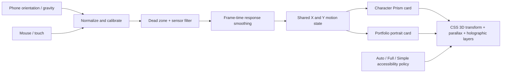

# Prism Tilt Lab v5 — How It Works

This is the experimental explanation. We'll expand into a full annotated tutorial and diagrams once the visual effect is approved.

## Data flow

## Mechanic

1. The browser supplies `deviceorientation` readings (beta/gamma), with `devicemotion` gravity fallback. The first reading establishes neutral tilt.
2. Sensor filter and dead zone reduce jitter. Response smoothing uses elapsed milliseconds instead of a fixed frame ratio.
3. One animation loop drives both sample images; their background art stays separate but shares rotation, gradient and foil settings.
4. Selective masks restrict the rainbow foil to chosen image areas. The character's armor mask is not aligned to the portrait, so the portrait uses a moving spot as its fallback.
5. Simple Mode turns off sensor listeners and all prism/parallax transforms. Auto follows the operating system's reduced-motion preference. Full FX explicitly enables the effect.
6. On browsers requiring a gesture to request permission, sensor startup must wait for the first button press. Otherwise it attempts to start automatically over HTTPS.

## Default Main Profile

- Prism: 74%, Highlights: 68%, 3D depth: 16°, Parallax: 13px
- Color bands: 4, Tilt sensitivity: 35, Blend: Soft Light
- Motion response: 35ms, Filter: 15ms, Dead zone: 0.5°

Use **Copy Portfolio FX JSON** or **Export Settings** to move a tested configuration into a future developer-only settings panel. Public settings should expose accessibility, not every technical slider.

## Next lessons

After approval: annotated architecture modules, a more detailed diagram showing transforms and CSS layers, profiling and comparing CSS against Canvas/WebGL, integration into MyPortfolio, then Ripple and other motion components using the shared accessibility policy.
